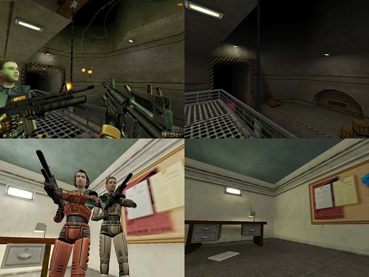
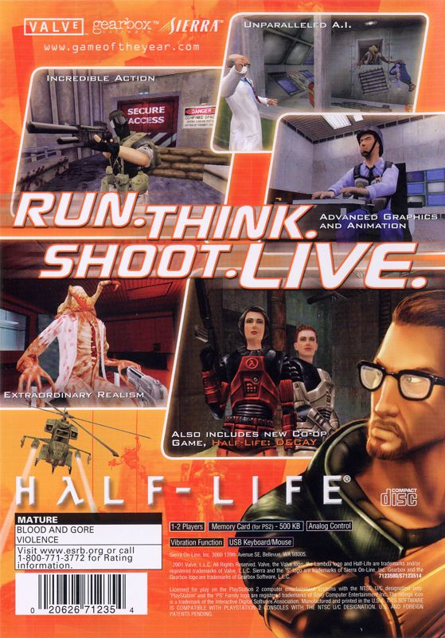

# half-life-decay-2001
## Half Life Decay 2001
A cooperative Half-Life Decay 2001 game was a PlayStation 2 version of Half-Life. 

## Github Treeview
[https://treegit.macosxjs.com/?url=igiteam/marines-modern-urban-combat-wii](https://treegit.macosxjs.com/?url=igiteam/marines-modern-urban-combat-wii)

## Github Tree Api Direct JSON
[https://api.github.com/repos/igiteam/marines-modern-urban-combat-wii/git/trees/main?recursive=1](https://api.github.com/repos/igiteam/marines-modern-urban-combat-wii/git/trees/main?recursive=1)

## Base Gameplay

## WS11WineCX20.0.4 (macOS Big Sur 32-bit)

[WS11WineCX20.0.4.tar.7z](https://github.com/vitor251093/porting-kit-engines/releases/download/wineskin/WS11WineCX20.0.4.tar.7z)

## Reference Links
[https://www.moddb.com/mods/half-life-decay-v102](https://www.moddb.com/mods/half-life-decay-v102)

[https://archive.org/details/half-life-1-pc-iso](https://archive.org/details/half-life-1-pc-iso)

"# Half-Life-Decay" 

Greetings curious human being! :)

This project's idea was born loooong ago, after I discovered that there is an exclusive PlayStation2 add-on for Half-Life.

Back in 2004 I was crazy about all things Half-Life and decided I was capable of brining it to PC. 

It was a long way, because to bring it to PC meant RECREATING the whole game, rebuilding all the maps and programming all game logic.

I was a complete nembie into doing something of that complexity, but didn't give up.

First it was Matrix-movie inspired deciphering of .bs2 format used by Gearbox-created version of Half-Life engine.

Then figuring out how to convert models and textures, then how to covert .bs2 into something similar to .bsp to be able to perform map decompilation.

Final steps would be re-create maps based off converted-decompiled maps and create all game logic part.

Personal discovery for me back then was understanding all the client-server nature of game objects and how one can create cooperative singleplayer of Half-Life game.

Project was created by two friends between 2004 and 2008 in Kyiv, Ukraine. 

Denys Zhatov recreated half of the maps.
Barnz ( Hayri from Instambul ) was responsible for recreating bonus level ( playable by vortigaunt ).

Thanks to Patrick Deupree from Gearbox for answering some of my questions about how original Decay game logic functioned. 

Slava Ukrajini!

Vyacheslav Dzhura aka "Hoaxer"   01.06.2022

## Dev Environment

**Official White Wii Remote With Nunchuk — Tested And Working — £14.99**
[https://www.ebay.co.uk/itm/800847189353](https://www.ebay.co.uk/itm/800847189353)

**Infrared Sensor Bar USB for Wii Emulator Remote Motion Detection Setup — £6.69**
[https://www.ebay.co.uk/itm/227423830875](https://www.ebay.co.uk/itm/227423830875)

**Apple MacBook Pro Retina 15in (2014) i7 2.8GHz 16GB 1TB SSD GT 750M — £120.30**
[https://www.ebay.co.uk/itm/800844561513](https://www.ebay.co.uk/itm/800844561513)

**WS11WineCX20.0.4 (Wine engine)**
[https://igiteam.github.io/wine_engines/](https://igiteam.github.io/wine_engines/)

**Official Genuine Sony PS3 PlayStation 3 DualShock 3 Wireless Controller Black — £19.99**
[https://www.ebay.co.uk/itm/840031043465](https://www.ebay.co.uk/itm/840031043465)

**Amazon Basics 4K HDMI Cable 3m — 18Gbps High Speed with Ethernet, 4K@60Hz, 2160p — £8.44**
[https://www.ebay.co.uk/itm/327352257557](https://www.ebay.co.uk/itm/327352257557)

**wiimote_nunchuk_macosx**
[https://github.com/igiteam/wiimote-nunchuk](https://github.com/igiteam/wiimote-nunchuk)

**xbox360_input_gui_py**
[https://github.com/igiteam/xbox360_input_gui_py](https://github.com/igiteam/xbox360_input_gui_py)

**logitec_mx_mouse_3_macos**
[https://github.com/igiteam/logitec_mx_mouse_3_macos](https://github.com/igiteam/logitec_mx_mouse_3_macos)

**igi1-macbook-3d-workstation**
[https://github.com/igiteam/igi1-macbook-3d-workstation](https://github.com/igiteam/igi1-macbook-3d-workstation)

---
